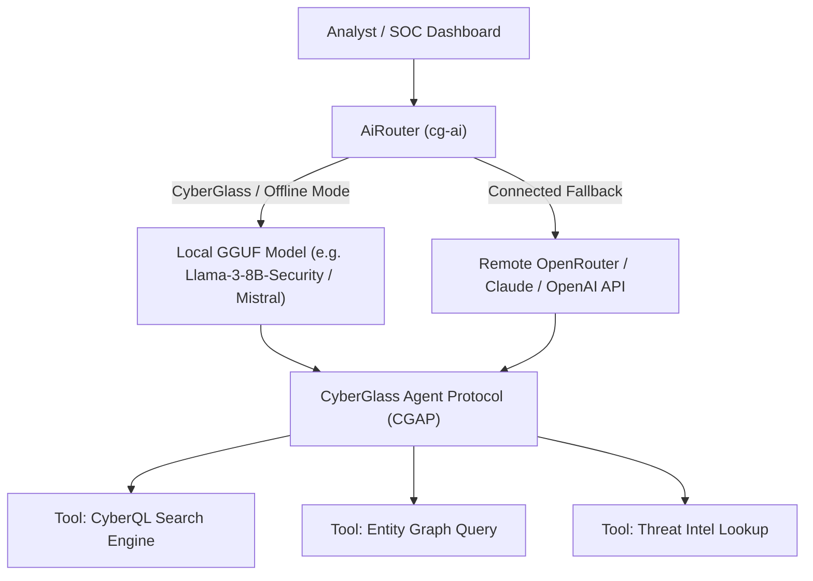

# 🤖 CyberGlass AI Engine & CGAP Protocol

CyberGlass provides built-in artificial intelligence designed specifically for **disconnected, cyberglass security operations centers (SOCs)** where no data can leave the perimeter.

---

## 1. Dual Model Architecture



1. **Local Self-Hosted GGUF Models**:
   - Executes quantized GGUF weights locally on CPU or GPU (AVX2, Neon, CUDA, Metal).
   - Zero outbound telemetry or external API calls.
   - Ideal for classified defense environments, critical infrastructure, and cyberglass enclaves.

2. **Remote OpenRouter Fallback**:
   - For connected or hybrid installations, CyberGlass can transparently route complex reasoning tasks to external frontier models via OpenAI-compatible endpoints.

---

## 2. CyberGlass Agent Protocol (CGAP)

CGAP is CyberGlass's security-native agent protocol (modeled after modern Model Context Protocol / MCP standards, but hardened for SIEM/SOC workflows):

- **Tool Registration**: Services expose deterministic, typed tools (e.g., `execute_cyberql`, `get_entity_blast_radius`, `isolate_host`).
- **Sandboxed Execution**: Agent actions are executed with least privilege and subject to strict RBAC.
- **Audit Hash Chaining**: Every AI decision and executed tool invocation is cryptographically signed and hash-chained into an immutable evidence log via `cg-crypto::hash_chain`.

---

## 3. Core AI Workflows

### 1. Natural Language to CyberQL Translation
Analysts can ask queries in plain English:
> *"Show me all blocked outbound traffic to unusual ports from finance hosts"*

The AI Engine translates this into optimized CyberQL:
```text
index="firewall" action="blocked" src_host="*fin*" dest_port!=80 dest_port!=443
| stats count by src_host, dest_ip, dest_port
| sort -count
```

### 2. Autonomous Alert Triage
When an alert triggers, the AI Engine:
1. Gathers context from the ontology graph (host criticality, user role, prior alerts).
2. Calculates false positive probability.
3. Produces an executive summary and recommended containment actions.
