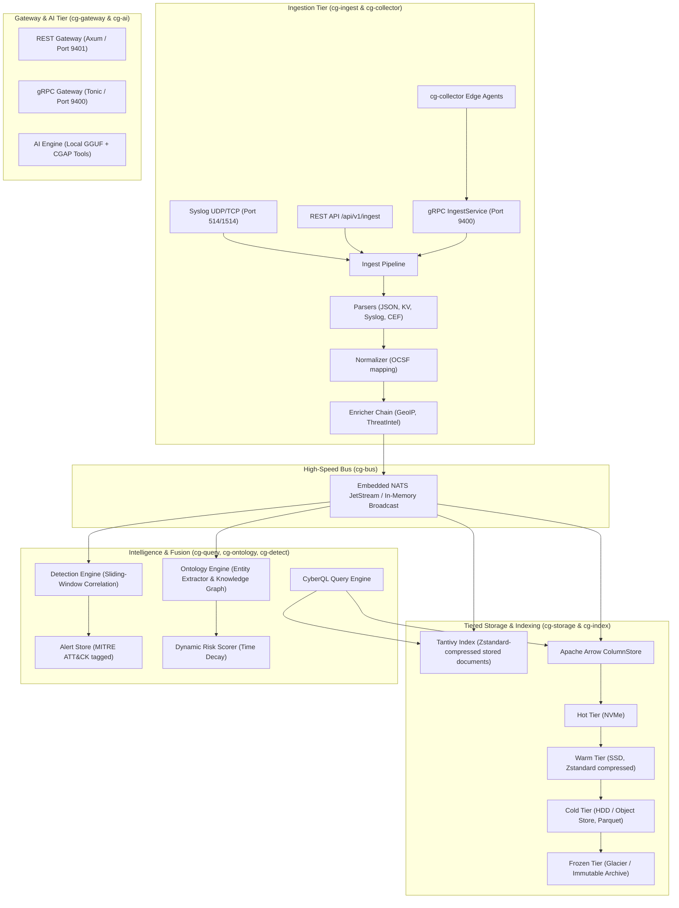

# 🏛️ CyberGlass System Architecture

CyberGlass is engineered from the ground up to overcome the latency, memory footprint, and phone-home limitations of legacy Java- and Python-based SIEM platforms.

---

## 1. High-Level Architecture Diagram

## 2. Index compression

External and internal Tantivy indexes use Zstandard level 3 for newly written
stored-document data. This setting does not compress every index structure:
postings, term dictionaries, and other segment files retain Tantivy's own
encoding. Existing segments remain readable with their original compressor;
they are not recompressed until they are merged or reindexed.

---

## 2. Storage Tiering Lifecycle

CyberGlass manages data through four distinct lifecycle tiers:

| Tier | Media | Storage Engine | Compression | Typical Retention |
|---|---|---|---|---|
| **Hot** | NVMe SSD | Tantivy Memory-Mapped Index + Arrow RecordBatches | None or LZ4 | 0 – 7 days |
| **Warm** | Standard SSD | Tantivy Segments + Arrow Parquet files | Zstandard (Level 3) | 7 – 30 days |
| **Cold** | Spinning HDD / Local NAS | Parquet files (Columnar) | Zstandard (Level 9) | 30 – 365 days |
| **Frozen** | Offline Tape / Cold Storage | Read-Only Immutable Archive | Maximum Zstd | 1 – 7+ years |

---

## 3. Concurrency and Zero-GC Safety

CyberGlass achieves deterministic performance by leveraging Rust's ownership model:
- **Lock-Free Concurrency**: Shared state (such as knowledge graph nodes and detection rules) utilizes `dashmap::DashMap`, providing concurrent sharded read/write access without global mutex contention.
- **Memory-Mapped I/O**: Tantivy index segments use `mmap` to rely directly on the kernel page cache, keeping resident memory usage lean while achieving multi-gigabyte-per-second search scans.
- **Zero-Copy Byte Slices**: Ingestion pipelines pass raw network payloads as immutable `bytes::Bytes` reference-counted slices, eliminating buffer copies between socket read, parsing, routing, and indexing.
