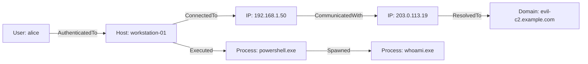

# 🕸️ Ontology and Knowledge Graph Fusion

CyberGlass combines raw log search with **CyberGlass Ontology intelligence**. As security events stream into the platform, entities are automatically extracted, deduplicated, linked by relationships, and continuously scored for risk.

---

## 1. The Entity Model

Instead of treating log lines as isolated text snippets, CyberGlass maintains stateful entities representing real-world assets and actors:

### Supported Entity Types
- `Host` — Workstations, servers, domain controllers
- `User` — Organization user accounts and service principals
- `IpAddress` — Internal and external IPv4 / IPv6 addresses
- `Domain` — Fully qualified domain names (FQDNs)
- `Url` — Web addresses and endpoints
- `FileHash` — SHA-256, SHA-1, MD5 cryptographic hashes
- `Process` — Running processes and process trees
- `Email` — Sender and recipient email addresses
- `Certificate` — X.509 certificates and fingerprints
- `Vulnerability` — CVE identifiers and software weaknesses
- `ThreatActor` / `Campaign` / `Malware` — Threat intelligence indicators

---

## 2. Automatic Entity Extraction

The `EntityExtractor` inspects incoming parsed events through a two-stage process:

1. **Structured Field Inspection**: Analyzes parsed fields for common schema conventions (`src_ip`, `dest_ip`, `user`, `host`, `sha256`, `process_name`).
2. **Raw Text Scanning**: Regex fallback for IP addresses, hashes, and URLs embedded in unformatted log messages.

Extracted entities are automatically merged into the concurrent `KnowledgeGraph`. If an entity already exists (matching `entity_type` + value), its `last_seen` timestamp and `event_count` are updated atomically.

---

## 3. Dynamic Risk Scoring with Time Decay

Each entity maintains a dynamic risk score between `0.0` and `100.0`. Risk is accumulated when detection rules trigger or high-severity events correlate with that entity.

### Exponential Time Decay Formula
To ensure historical incidents do not permanently elevate an asset's risk score, risk contributions decay over time:

$$R(t) = R_0 \cdot e^{-\lambda \Delta t}$$

Where:
- $R_0$ is the initial risk contribution score.
- $\lambda$ is the daily decay rate (default: $0.15$).
- $\Delta t$ is the elapsed time in days.

### Risk Levels
- **None**: $0.0 – 9.9$
- **Low**: $10.0 – 39.9$
- **Medium**: $40.0 – 69.9$
- **High**: $70.0 – 89.9$
- **Critical**: $90.0 – 100.0$

---

## 4. Graph Traversal

Analysts can explore lateral movement paths using breadth-first search (BFS) graph traversal via gRPC or REST:
- **Outbound**: Entities that this entity reached out to or spawned.
- **Inbound**: Entities that targeted, accessed, or authenticated to this entity.
- **Bi-directional**: Complete blast radius visualization up to $N$ hops.
